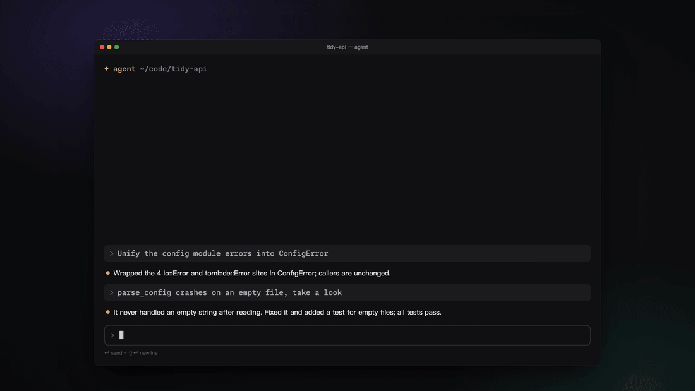

<p align="center">
  
</p>

<h1 align="center">Nekro Qantrip</h1>

<p align="center">
  <strong>An open-source prompt launcher. Press <kbd>⌃Q</kbd>, type a few keys, and a complete prompt lands in whatever app you're using.</strong>
</p>

<p align="center">
  <a href="https://qantrip.nekro.ai">Website</a> ·
  <a href="https://qantrip.nekro.ai/#demo">Try it in your browser</a> ·
  <a href="https://github.com/NekroAI/qantrip/releases/latest">Download</a> ·
  <a href="README.zh-CN.md">中文</a>
</p>

<p align="center">
  <a href="https://github.com/NekroAI/qantrip/actions/workflows/ci.yml"></a>
  
  <a href="LICENSE"></a>
</p>

> **Qantrip** is pronounced like *cantrip* — the D&D spell you can cast again and again at no cost. The **Q** is the key you press to cast one. It is not a typo.



## Why

If you work with Claude Code, Codex, Cursor or a chat window all day, you retype the same instructions over and over: *review the staged changes, focus on security, don't edit files…* Snippet tools can paste fixed text, but real prompts need small variations every time.

Qantrip turns your prompts into **parameterized templates** you call with a short command:

```text
r security --scope=staged -s focus on the auth module
│ │        │              │  └ free text, appended verbatim
│ │        │              └ short flag (-s = --strict)
│ │        └ option with a value (prefixes work: --sc=st)
│ └ positional value for the template's main parameter
└ template name or alias
```

…and inserts the rendered prompt into the app you were using, without touching your clipboard history and without accidentally submitting multi-line text in a terminal.

## Features

- **Discoverable command line** — exact, prefix and fuzzy matching; inline ghost completion; type `--` to see every parameter; <kbd>↩</kbd> inserts exactly what the preview shows and <kbd>⇥</kbd> completes, so one keystroke is enough even with a typo.
- **See what you'll insert** — a live preview highlights exactly which lines each parameter and your free text changed.
- **Templates are Markdown files** — YAML front matter declares parameters (bool, enum, multi-select, string, number, text); the body is a [MiniJinja](https://github.com/mitsuhiko/minijinja) template. Edit them in any editor, or in the built-in library with a form editor, live preview and validation.
- **Insertion that stays out of your way** — paste-based (terminals and AI agents won't treat newlines as <kbd>Enter</kbd>), your clipboard is restored afterwards and the prompt is marked transient so clipboard managers skip it. No Accessibility permission? It falls back to copy-only.
- **Built for AI coding agents** — 17 built-in templates in English and Chinese (review, fix, debug, test, refactor, commit, PR, …); <kbd>⌘↩</kbd> expands Claude Code's collapsed `[Pasted text]` placeholder.
- **Keyboard first, mouse friendly** — every parameter chip is clickable, and clicks rewrite the command line, so mouse and keyboard always agree.
- **Local first** — search, rendering and insertion work offline. Optional sync is [end-to-end encrypted](docs/sync-design.md).

## Install

Download the DMG — [Apple silicon](https://github.com/NekroAI/qantrip/releases/latest/download/Qantrip-macOS-arm64.dmg) or [Intel](https://github.com/NekroAI/qantrip/releases/latest/download/Qantrip-macOS-x86_64.dmg) — open it and drag **Qantrip** into Applications. Requires macOS 14 or later.

Qantrip isn't notarized by Apple yet, so macOS blocks the first launch: open **System Settings → Privacy & Security** and click **Open Anyway**. Updates keep your permissions and templates.

**Windows:** download and run [Qantrip-Windows-x64-Setup.exe](https://github.com/NekroAI/qantrip/releases/latest/download/Qantrip-Windows-x64-Setup.exe) (no admin rights needed; a portable [zip](https://github.com/NekroAI/qantrip/releases/latest/download/Qantrip-Windows-x64.zip) is also available), then press <kbd>Ctrl+Q</kbd>. It isn't code-signed yet, so SmartScreen may ask you to click **More info → Run anyway**. Requires Windows 10 2004 or later (x64).

**Linux (preview):** download the AppImage — [x86_64](https://github.com/NekroAI/qantrip/releases/latest/download/Qantrip-Linux-x86_64.AppImage) or [ARM64](https://github.com/NekroAI/qantrip/releases/latest/download/Qantrip-Linux-aarch64.AppImage) — make it executable and run it, or install the [.deb](https://github.com/NekroAI/qantrip/releases/latest/download/Qantrip-Linux-x86_64.deb) / [.rpm](https://github.com/NekroAI/qantrip/releases/latest/download/Qantrip-Linux-x86_64.rpm) (ARM64: `Qantrip-Linux-aarch64.deb` / `.rpm`). Press <kbd>Ctrl+Q</kbd>; on GNOME and KDE (Wayland) the system asks you to confirm the shortcut, and the welcome guide lets you allow auto-paste once. Requires GTK 4.14+ and libadwaita 1.5+ (Ubuntu 24.04, Debian 13, Fedora 40 or later). See [docs/install.md](docs/install.md).

## Writing a template

Create `~/Library/Application Support/Qantrip/templates/review.md` (Linux: `~/.local/share/qantrip/templates/`):

```markdown
---
name: review
aliases: [r]
description: Code review
params:
  focus:
    type: multi
    positional: true
    choices: [security, performance]
  strict: { type: bool, short: s, description: Report every doubt }
---
Review the current changes.
Focus on: {{ focus | join(", ") }}.
List anything uncertain and give a confidence level.

```

Qantrip reloads it automatically. A file with the same name as a built-in template overrides it. You can also create and edit templates in the built-in library:


The full format is described in the [input grammar](docs/input-grammar.md) and on the [website](https://qantrip.nekro.ai/docs#templates).

## Project status

| Area | Status |
|---|---|
| macOS app (panel, grammar, templates, library, settings, onboarding) | ✅ English and Chinese |
| Online demo (core compiled to WebAssembly) | ✅ [qantrip.nekro.ai](https://qantrip.nekro.ai) |
| Sync server (Cloudflare Workers + D1, ciphertext only) | ✅ deployed |
| End-to-end encrypted sync | ✅ macOS, Windows, Linux — [design](docs/sync-design.md) |
| Command mode for creating templates in the panel | ✅ |
| Windows | ✅ Windows 10/11 x64 (installer or portable zip) |
| Linux | 🧪 preview (x86_64 / ARM64; AppImage, .deb, .rpm; GNOME, KDE Plasma, X11) |
| AI-assisted template editing | 📝 planned |

## Architecture

```text
┌──────────────────────────── core/ (Rust) ────────────────────────────┐
│ input grammar · template library · MiniJinja rendering · usage ranking │
└───────────┬───────────────────────┬───────────────────────────────────┘
            │ UniFFI                 │ wasm-bindgen
┌───────────▼──────────┐   ┌─────────▼──────────────┐   ┌──────────────────────────┐
│ apps/macos (Swift)   │   │ website demo (WASM)     │   │ apps/cloud (Workers)     │
│ AppKit + SwiftUI     │   │ same parser, same       │   │ website · accounts ·     │
│ hotkey · panel ·     │   │ templates, in the       │   │ E2EE sync API (opaque    │
│ paste · library      │   │ browser                 │   │ ciphertext, D1 + R2)     │
└──────────────────────┘   └─────────────────────────┘   └──────────────────────────┘
```

Each platform gets a native shell over a shared Rust core rather than a cross-platform UI framework — see [decision D6](docs/decisions.md).

| Path | Contents |
|---|---|
| [`core/`](core) | Rust core: grammar, templates, rendering, usage ranking; built-in templates in `core/templates/` |
| [`core/wasm/`](core/wasm) | WebAssembly bindings for the website demo |
| [`apps/macos/`](apps/macos) | macOS app (Swift, SwiftPM — no Xcode project required) |
| [`apps/linux/`](apps/linux) | Linux app (Rust, GTK4 + libadwaita, links the core directly) |
| [`apps/cloud/`](apps/cloud) | Website and sync server (Cloudflare Workers, React Router, Hono, D1) |
| [`docs/`](docs) | Product requirements, input grammar, sync security design, decision log |
| [`scripts/`](scripts) | Build, packaging and signing scripts |

## Development

```sh
cargo test --manifest-path core/Cargo.toml     # core tests
scripts/build-macos.sh                          # macOS app (dev-signed)
cargo run --manifest-path apps/linux/Cargo.toml # Linux app (needs GTK 4.14+ / libadwaita 1.5+ dev packages)
scripts/package-linux.sh                        # Linux AppImage, .deb and .rpm
scripts/build-wasm.sh                           # WebAssembly core for the website
cd apps/cloud && pnpm install && pnpm test      # website + server contract tests
```

Design documents in `docs/` are written in Chinese; code, comments and commit messages follow the language of the surrounding code. See [CONTRIBUTING.md](CONTRIBUTING.md).

## Security

Sync is end-to-end encrypted: keys are generated on your devices, and the server only stores ciphertext it cannot decrypt. The threat model, key hierarchy and the metadata the server *can* see are documented in [docs/sync-design.md](docs/sync-design.md). Please report vulnerabilities privately — see [SECURITY.md](SECURITY.md).

## License

- Client and core: [GPL-3.0-or-later](LICENSE)
- Sync server (`apps/cloud/`): [AGPL-3.0-or-later](apps/cloud/LICENSE)
- Bundled fonts Monaspace Neon and Fraunces: SIL Open Font License 1.1

Made by [NekroAI](https://github.com/NekroAI).
