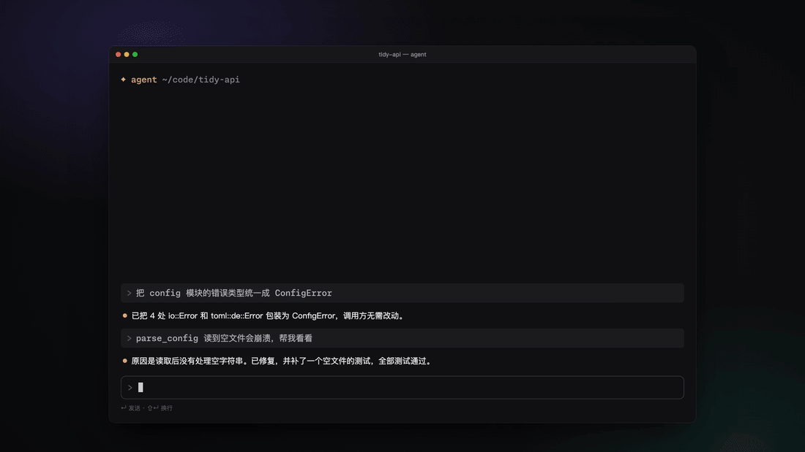
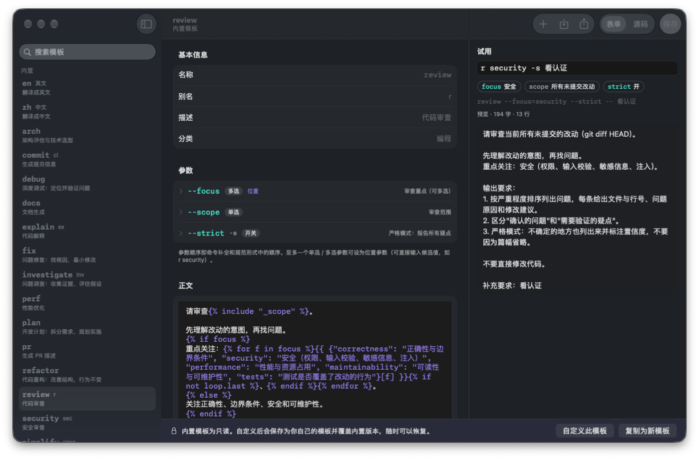

<p align="center">
  
</p>

<h1 align="center">Nekro Qantrip</h1>

<p align="center">
  <strong>开源的 Prompt 启动器。按下 <kbd>⌃Q</kbd>，敲几个键，完整的 Prompt 就出现在你正在用的应用里。</strong>
</p>

<p align="center">
  <a href="https://qantrip.nekro.ai">官网</a> ·
  <a href="https://qantrip.nekro.ai/#demo">在浏览器里试用</a> ·
  <a href="https://github.com/NekroAI/qantrip/releases/latest">下载</a> ·
  <a href="README.md">English</a>
</p>

> **Qantrip** 读作 /ˈkæntrɪp/，与 cantrip 同音——D&D 里不耗资源、可以随手反复施放的"戏法"。首字母换成 **Q**，就是唤起它的那个键。不是拼写错误。



## 为什么做它

整天和 Claude Code、Codex、Cursor 或聊天窗口打交道的人，会一遍遍重复输入同样的要求：审查暂存区的改动、重点看安全、先不要改文件……文本片段工具只能粘贴固定的文字，而真实的 Prompt 每次都有细微差别。

Qantrip 把 Prompt 变成**带参数的模板**，用一条短命令调用：

```text
r security --scope=staged -s 重点看认证模块
│ │        │              │  └ 附加要求：原样附在末尾
│ │        │              └ 短参数（-s 即 --strict）
│ │        └ 带值的参数（可以只输前缀：--sc=st）
│ └ 位置参数：直接输入候选值
└ 模板名或别名
```

回车后，渲染好的 Prompt 插入到你刚才所在的应用；不会污染剪贴板历史，也不会让终端把多行文本当作回车提交。

## 功能

- **可发现的命令行**：精确、前缀、模糊三层匹配；灰字补全；输入 `--` 列出全部参数；回车插入右侧预览显示的内容，Tab 负责补全，拼错时也只需一次回车。
- **插入前看得到结果**：实时预览，标出每个参数和附加要求改变了哪些内容。
- **模板就是 Markdown 文件**：YAML 头部声明参数（开关、单选、多选、文本、数字、多行文本），正文是 [MiniJinja](https://github.com/mitsuhiko/minijinja) 模板。可以用任何编辑器修改，也可以在内置的模板库里用表单编辑、试用、校验。
- **插入时不打扰你**：以粘贴方式插入，完成后还原剪贴板，Prompt 标记为临时内容，剪贴板管理器不会记录。没有辅助功能权限时自动改为只复制。
- **为 AI 编程代理而做**：17 个内置模板（中英文两套）（审查、修复、调试、测试、重构、提交信息、PR 描述等）；<kbd>⌘↩</kbd> 让 Claude Code 中被折叠的 `[Pasted text]` 展开。
- **键盘优先，鼠标也顺手**：参数标签都可以点，点击会改写命令行，键盘与鼠标的结果始终一致。
- **本地优先**：搜索、渲染、插入全部离线可用。可选的同步[端到端加密](docs/sync-design.md)。

## 安装

下载 DMG：[Apple 芯片](https://github.com/NekroAI/qantrip/releases/latest/download/Qantrip-macOS-arm64.dmg) 或 [Intel 芯片](https://github.com/NekroAI/qantrip/releases/latest/download/Qantrip-macOS-x86_64.dmg)，打开后把 **Qantrip** 拖进「应用程序」即可。需要 macOS 14 或更新版本。

Qantrip 尚未经过 Apple 公证，首次打开会被系统拦截：到 **系统设置 → 隐私与安全性** 点 **仍要打开**。之后更新会保留权限与模板。

**Windows（预览版）：** 下载并运行 [Qantrip-Windows-x64-Setup.exe](https://github.com/NekroAI/qantrip/releases/latest/download/Qantrip-Windows-x64-Setup.exe)（不需要管理员权限；也提供便携版 [zip](https://github.com/NekroAI/qantrip/releases/latest/download/Qantrip-Windows-x64.zip)），按 <kbd>Ctrl+Q</kbd> 唤起。程序暂未签名，SmartScreen 可能需要点 **更多信息 → 仍要运行**。需要 Windows 10 2004 或更新版本（x64）。

**Linux（预览版）：** 下载 AppImage——[x86_64](https://github.com/NekroAI/qantrip/releases/latest/download/Qantrip-Linux-x86_64.AppImage) 或 [ARM64](https://github.com/NekroAI/qantrip/releases/latest/download/Qantrip-Linux-aarch64.AppImage)——设为可执行后运行；也可以安装 [.deb](https://github.com/NekroAI/qantrip/releases/latest/download/Qantrip-Linux-x86_64.deb) / [.rpm](https://github.com/NekroAI/qantrip/releases/latest/download/Qantrip-Linux-x86_64.rpm)（ARM64 为 `Qantrip-Linux-aarch64.deb` / `.rpm`）。按 <kbd>Ctrl+Q</kbd> 唤起；GNOME、KDE（Wayland）会请你确认快捷键，引导中可以授权一次自动粘贴。需要 GTK 4.14+ 与 libadwaita 1.5+（Ubuntu 24.04、Debian 13、Fedora 40 或更新版本），详见 [docs/install.md](docs/install.md)。

## 编写模板

新建 `~/Library/Application Support/Qantrip/templates/review.md`（Linux 为 `~/.local/share/qantrip/templates/`）：

```markdown
---
name: review
aliases: [r]
description: 代码审查
params:
  focus:
    type: multi
    positional: true
    choices: [security, performance]
  strict: { type: bool, short: s, description: 报告所有疑点 }
---
请审查当前改动。
重点关注：{{ focus | join("、") }}。
不确定的地方也列出来，并标注置信度。

```

Qantrip 会自动重新加载。与内置模板同名的文件会覆盖内置版本。也可以在内置的模板库里创建和编辑模板：



完整格式见 [输入语法规范](docs/input-grammar.md) 与 [官网文档](https://qantrip.nekro.ai/docs#templates)。

## 项目状态

| 方面 | 状态 |
|---|---|
| macOS 应用（面板、语法、模板、模板库、设置、引导） | ✅ 0.2.0，中英双语 |
| 在线演示（核心编译为 WebAssembly） | ✅ [qantrip.nekro.ai](https://qantrip.nekro.ai) |
| 同步服务端（Cloudflare Workers + D1，只存密文） | ✅ 已部署 |
| 端到端加密同步 | ✅ 0.2.0，见 [设计](docs/sync-design.md) |
| 面板内快速创建模板的指令模式 | 📝 计划中 |
| Windows | 🧪 0.3.0 预览版（x64 压缩包） |
| Linux | 🧪 预览版（x86_64 / ARM64；AppImage、deb、rpm；GNOME、KDE Plasma、X11） |
| AI 辅助编辑模板 | 📝 计划中 |

## 架构

各平台使用原生界面，共享同一个 Rust 核心，不使用跨平台 UI 框架（见 [决策 D6](docs/decisions.md)）。核心通过 UniFFI 接入 macOS 应用，通过 WebAssembly 运行在官网的在线演示里。

| 路径 | 内容 |
|---|---|
| [`core/`](core) | Rust 核心：语法、模板、渲染、使用排序；内置模板在 `core/templates/` |
| [`core/wasm/`](core/wasm) | 官网演示用的 WebAssembly 绑定 |
| [`apps/macos/`](apps/macos) | macOS 应用（Swift、SwiftPM，不需要 Xcode 工程） |
| [`apps/linux/`](apps/linux) | Linux 应用（Rust、GTK4 + libadwaita，直接调用核心） |
| [`apps/cloud/`](apps/cloud) | 官网与同步服务端（Cloudflare Workers、React Router、Hono、D1） |
| [`docs/`](docs) | 产品需求、输入语法、同步安全设计、决策记录 |
| [`scripts/`](scripts) | 构建、打包与签名脚本 |

## 开发

```sh
cargo test --manifest-path core/Cargo.toml     # 核心测试
scripts/build-macos.sh                          # macOS 应用（开发签名）
cargo run --manifest-path apps/linux/Cargo.toml # Linux 应用（需要 GTK 4.14+ / libadwaita 1.5+ 开发包）
scripts/package-linux.sh                        # Linux 的 AppImage、deb 与 rpm
scripts/build-wasm.sh                           # 官网用的 WebAssembly 核心
cd apps/cloud && pnpm install && pnpm test      # 官网与服务端契约测试
```

参与贡献请先阅读 [CONTRIBUTING.md](CONTRIBUTING.md)。

## 安全

同步采用端到端加密：密钥在你的设备上生成，服务端只保存无法解密的密文。威胁模型、密钥层级以及服务端能看到的元数据见 [docs/sync-design.md](docs/sync-design.md)。发现漏洞请私下报告，见 [SECURITY.md](SECURITY.md)。

## 许可证

- 客户端与核心：[GPL-3.0-or-later](LICENSE)
- 同步服务端（`apps/cloud/`）：[AGPL-3.0-or-later](apps/cloud/LICENSE)
- 内置字体 Monaspace Neon 与 Fraunces：SIL Open Font License 1.1

由 [NekroAI](https://github.com/NekroAI) 开发。
